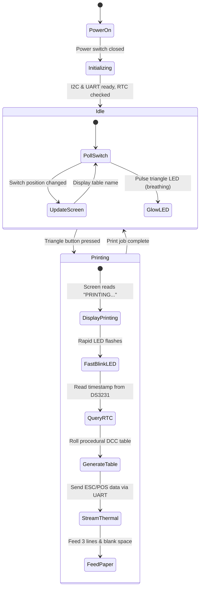

# DCC Printer (Dungeon Crawl Classics Thermal Receipt Generator)

An electromechanical gaming artifact and tabletop prop that prints procedurally generated *Dungeon Crawl Classics* (DCC) RPG tables, 0-level characters, and creatures onto 58mm thermal paper.

---

## 1. Bill of Materials & Component Specifications

| Component | Description | Reference | Specifications |
| :--- | :--- | :--- | :--- |
| **Thermal**<br>**Printer** | Cashino CSN-A2<br>Panel Printer | [cashino.pdf](cashino-printer.pdf) | 58mm roll (48mm print)<br>TTL UART (9600 baud)<br>5V–9V DC (≥2A peak) |
| **Rotary**<br>**Switch** | SR16A-18-15KQ<br>8-Position | [rotary.pdf](rotary-switch-SR16A-18-15KQ.pdf) | 1-pole 8-position<br>15mm knurled shaft |
| **Knob** | Pointer Control<br>Knob | [knob.pdf](knob.pdf) | Knurled shaft pointer<br>with position line |
| **Trigger**<br>**Button** | Illuminated Triangle<br>Pushbutton | [button.jpg](triangle-button.jpg) | Momentary microswitch<br>with PWM LED |
| **Micro-**<br>**controller** | Raspberry Pi Pico<br>(RP2040) | Standard 40-pin DIP | Dual-core Cortex-M0+<br>CircuitPython |
| **OLED**<br>**Display** | SSD1306 Mono<br>Display | I2C (Address `0x3C`) | 128x32 or 128x64<br>mode & status screen |
| **Real-Time**<br>**Clock** | DS3231 Precision<br>RTC Module | I2C (Address `0x68`) | Battery-backed clock<br>for receipt timestamp |
| **Power**<br>**Socket** | 5.5 x 2.1mm DC<br>Barrel Jack | Panel Mount | 5V DC input rated<br>for 3.0A minimum |
| **Power**<br>**Switch** | Latching SPST<br>Toggle Switch | In-line 5V DC | Main system power<br>cut-off switch |

---

## 2. Documentation Modules

The documentation is divided into specialized modules:

1. **[Wiring & Power Architecture](wiring.md)**:
   - Complete system wiring map and interconnect diagram.
   - GPIO pinout table for Raspberry Pi Pico.
   - Dual-rail power distribution (5V high-current & 3.3V logic).
   - In-depth guide: **Understanding Low-Impedance Star Grounding** (physics of ground bounce, noise immunity, decoupling).

2. **[DCC Generator Tables & Receipt Layouts](dcc-tables.md)**:
   - The 8 rotary switch positions:
     1. DCC RPG (0-Level Funnel)
     2. MCC RPG (0-Level Funnel)
     3. Umerica (0-Level Funnel)
     4. X-Crawl (0-Level Funnel)
     5. DCC Lankhmar (0-Level Funnel)
     6. DCC Empire of the East (0-Level Funnel)
     7. DCC Dying Earth (0-Level Funnel)
     8. Beast-o-Matic (Procedural Random Monster)
   - 58mm thermal print area constraints (32-character column limit).
   - Reusable 32-column ASCII art headers (Horned Demon Skull, Monster Head, Radioactive Skull).
   - Formatted receipt mockups.

---

## 3. Firmware State Machine & Operational Flow



### Display States:
- **Resting / Idle Loop**: Displays the active mode name in large text:
  ```
  +--------------------+
  | [01] 0-LVL FUNNEL  |
  | PRESS BUTTON TO ROLL|
  +--------------------+
  ```
- **Printing State**: Displays feedback and animated print indicator:
  ```
  +--------------------+
  | *** PRINTING ***   |
  | PLEASE WAIT...     |
  +--------------------+
  ```

---

## 4. Hardware Assembly Checklist

- [ ] Solder 40-pin header pins to the Raspberry Pi Pico.
- [ ] Connect I2C bus (`GP0` SDA, `GP1` SCL) with shared 3.3V power to SSD1306 and DS3231.
- [ ] Connect UART1 TX (`GP4`) to Cashino RX and UART1 RX (`GP5`) to Cashino TX.
- [ ] Wire rotary switch positions 1–8 to pins `GP6` through `GP13` with rotary common to logic GND.
- [ ] Wire triangle button microswitch to `GP14` and button LED anode to `GP15` (PWM).
- [ ] Install 470µF–1000µF capacitor across the Cashino power connector.
- [ ] Establish **low-impedance star ground** from DC power jack negative terminal.
