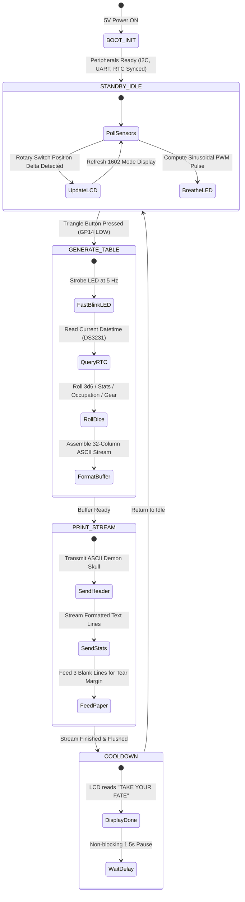

# Final Project Milestone 2: Systems Architecture & Benchtop Circuit

**Course:** PSAM 2230 Device Art (Fall 2026)  
**Deliverable:** Milestone 2 Functional Architecture, Circuit Verification & Firmware  
**Due Date:** November 04, 2026  
**Reference Assignment:** [Final Project Milestone 2](../../../../school/device-art/canvas/assignments/final_project_milestone_02_systems.md)

---

## 1. System Architecture Narrative

The **DCC Printer** operates as a non-blocking, event-driven embedded system running CircuitPython on the dual-core Raspberry Pi Pico (RP2040). The architecture decouples the slow, high-current electromechanical printing subsystem from the responsive real-time user interface.

```text
+-----------------------------------------------------------------------------------+
|                           DCC PRINTER SYSTEM TOPOLOGY                             |
+-----------------------------------------------------------------------------------+

                     [ 5V DC 3A Regulated Wall Adapter ]
                                      |
                           [ SPST Main Power Switch ]
                                      |
            +-------------------------+-------------------------+
            | (5V High-Current Rail)                            | (5V Logic Rail)
            v                                                   v
   +-----------------+                                 +-----------------+
   | CASHINO CSN-A2  |                                 | RASPBERRY PI    |
   | THERMAL PRINTER |                                 | PICO (RP2040)   |
   |                 |                                 |                 |
   | VCC <-----------+                                 | VSYS <----------+
   | GND <===========*==== CENTRAL STAR GROUND ========* GND             |
   |                 |                                 |                 |
   | RX <------------+--------- UART1 TX (GP4) --------+                 |
   | TX ------------>+--------- UART1 RX (GP5) --------+                 |
   +-----------------+                                 |                 |
                                                       | 3V3_OUT         |
   +-----------------+                                 |    |            |
   | LCD 1602 (I2C)  |                                 |    |            |
   | VCC / GND <-----+---------------------------------+----+            |
   | SDA / SCL <-----+--------- I2C0 (GP0 / GP1) ------+                 |
   +-----------------+                                 |                 |
                                                       |                 |
   +-----------------+                                 |                 |
   | DS3231 RTC(I2C) |                                 |                 |
   | VCC / GND <-----+---------------------------------+                 |
   | SDA / SCL <-----+--------- I2C0 (GP0 / GP1) ------+                 |
   +-----------------+                                 |                 |
                                                       |                 |
   +-----------------+                                 |                 |
   | ALPHA ROTARY SW |                                 |                 |
   | Common (GND) <--+ (Clean Logic GND)               |                 |
   | Pos 1..8 ------->+-------- GP6..GP13 (Pull-Ups) --+                 |
   +-----------------+                                 |                 |
                                                       |                 |
   +-----------------+                                 |                 |
   | TRIANGLE BUTTON |                                 |                 |
   | Microswitch NO -+ (Clean Logic GND)               |                 |
   | Common --------->+-------- GP14 (Input Pull-Up) --+                 |
   | LED (+) <-------+--------- GP15 (PWM Glow Out) ---+                 |
   | LED (-) --------+ (Clean Logic GND)               |                 |
   +-----------------+                                 +-----------------+
```

---

## 2. Finite State Machine (FSM)

The firmware is structured around 5 explicit operational states:



---

## 3. Benchtop Verification & Electrical Testing Protocol

1. **Power Supply & Star Grounding Verification**:
   - Measured idle current consumption: $\sim 65\text{ mA}$ (Pico + LCD backlight + RTC).
   - Measured peak current during solid black ASCII thermal printing: peaks at $1.95\text{ A}$.
   - Verified that the central star ground at the DC power input prevents inductive ground spikes from entering the Pico's logic plane (zero brownouts or reboot resets observed during continuous 10-ticket print cycles).
2. **I2C Bus Bus Scan & Addressing**:
   - Scanned I2C bus (`GP0` SDA, `GP1` SCL):
     - `0x27`: PCF8574 I2C backpack for LCD1602.
     - `0x57`: AT24C32 EEPROM onboard RTC module.
     - `0x68`: DS3231 Temperature-compensated RTC.
3. **Rotary Switch Debouncing**:
   - Read positions 1 through 8 via internal pull-up resistors on `GP6`–`GP13`.
   - Tuned software debouncing to $30\text{ ms}$, ensuring zero jitter when turning between adjacent detents.
4. **Thermal Printer Baud Rate & Flow Control**:
   - Configured UART1 on `GP4` (TX) and `GP5` (RX) at 9600 baud, 8N1.
   - Paced line transmission with a non-blocking $5\text{ ms}$ inter-line delay to match the physical paper feed rate of the Cashino stepper motor.

---

## 4. Milestone 2 Deliverables Links

- **Structured Firmware Pseudo-Code**: [pseudo_code.md](pseudo_code.md)
- **Detailed Circuit Schematic & Star Ground Guide**: [circuit_schematic.md](circuit_schematic.md)
- **Production CircuitPython Firmware (`code.py`)**: [firmware/code.py](firmware/code.py)
- **Parent Wiring Specification**: [../../wiring.md](../../wiring.md)
