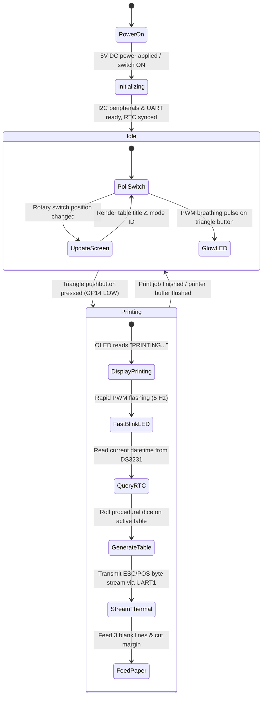

# DCC Printer Firmware & Operational State Machine

This document details the software architecture, state machine, display interfaces, and operational flow for the Dungeon Crawl Classics thermal receipt printer running CircuitPython on the Raspberry Pi Pico.

---

## 1. Operational State Machine



---

## 2. OLED Display States (SSD1306)

The 128x32 / 128x64 monochrome OLED provides continuous visual feedback for switch selection and print progress:

### Resting / Idle State
When turning the 8-position selector knob, the display updates instantly to show the active generator mode:

```
+------------------------------------+
| MODE: [01] 0-LEVEL FUNNEL          |
| > PRESS TRIANGLE BUTTON TO ROLL <  |
+------------------------------------+
```

```
+------------------------------------+
| MODE: [08] BEAST-O-MATIC           |
| > PROCEDURAL MONSTER GENERATOR <   |
+------------------------------------+
```

### Printing State
While character or table generation is executing and streaming over the UART serial bus:

```
+------------------------------------+
| *** PRINTING RECEIPT ***           |
| PLEASE WAIT FOR TEAR-OFF...        |
+------------------------------------+
```

### Error / Out of Paper State
If the Cashino printer reports an error or the paper roll is depleted:

```
+------------------------------------+
| [!] PRINTER OFFLINE / NO PAPER     |
| CHECK 58MM PAPER ROLL & LATCH      |
+------------------------------------+
```

---

## 3. CircuitPython Software Architecture

### Core Modules & Libraries
- `busio.UART`: Communicates with Cashino CSN-A2 over `GP4` (TX) and `GP5` (RX) at 9600 baud.
- `busio.I2C`: Manages SSD1306 display (`0x3C`) and DS3231 RTC (`0x68`) on `GP0` (SDA) and `GP1` (SCL).
- `adafruit_displayio_ssd1306`: Drives the OLED UI.
- `adafruit_ds3231`: Reads battery-backed timestamps for receipt headers.
- `digitalio`: Reads the 8-position rotary switch pins (`GP6`..`GP13`) and triangle button switch (`GP14`).
- `pwmio`: Modulates the triangle pushbutton LED (`GP15`) for idle breathing and active print flashing.

### Button & Rotary Debouncing
- Rotary selector inputs (`GP6`..`GP13`) use internal pull-up resistors (`Pull.UP`). When a switch position connects common to ground, that pin reads `False`.
- Debounce threshold: 30ms stable state before committing a mode change.
- Button press triggers on falling edge (`HIGH` to `LOW`) with 50ms software lockout to prevent duplicate print jobs.
